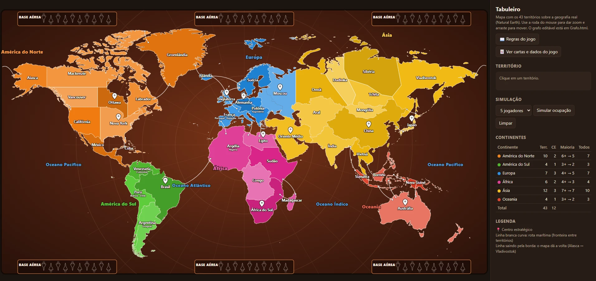
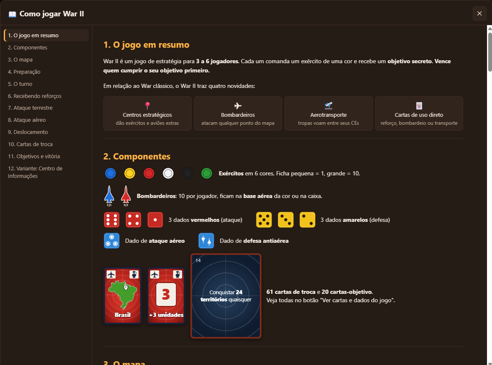
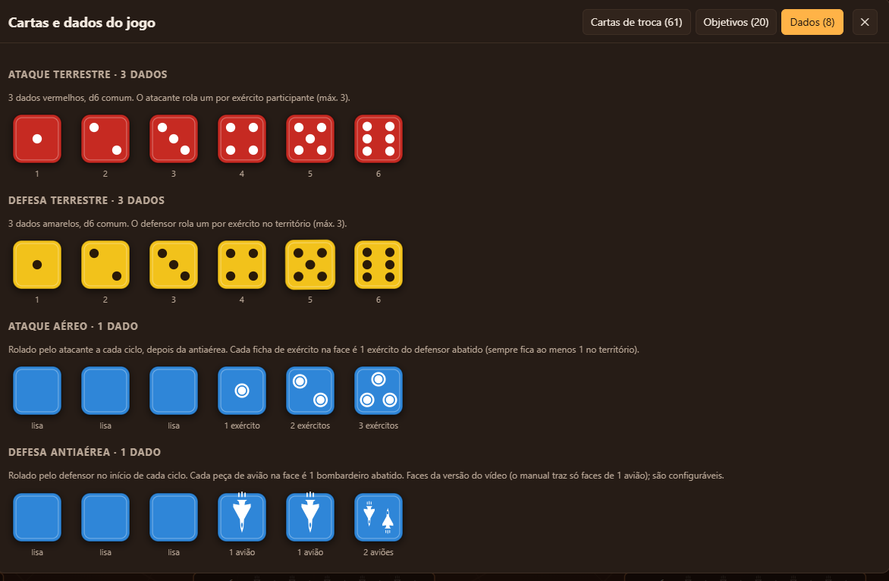

# War II Online

Projeto web para jogar **War II** (jogo de tabuleiro da Grow) online entre amigos, de 3 a 6 jogadores, em turnos.

> **Status:** o jogo já roda de ponta a ponta no navegador: contas, lobby com convite, servidor em tempo real e a tela da partida com o mapa, o painel de cada fase (ocupação, recebimento, ataques terrestre e aéreo com os dados animados, deslocamento, cartas), a tela de vitória, a galeria de cartas e dados e o guia de regras. O motor de regras (engine) e o servidor têm testes automatizados. Próximos passos: endurecimento de segurança, deploy e playtest.

## Conteúdo do repositório

| Caminho | O que é |
|---|---|
| [`WARII.md`](WARII.md) | Especificação das regras — fonte de verdade para a implementação (mapa, preparação, turno, combate, cartas, objetivos, variante Centro de Informações, modelo de dados e parâmetros configuráveis) |
| [`Tabuleiro.html`](Tabuleiro.html) | Protótipo do mapa (D3 + TopoJSON) com territórios, continentes, centros estratégicos e bases aéreas; inclui galeria de cartas e dados e um guia de regras com calculadora de reforços e simuladores de ataque. Basta abrir no navegador |
| [`packages/`](packages) | Código do jogo (monorepo, ver abaixo) |

## Protótipo

**Tabuleiro** — os 43 territórios sobre a geografia real, com continentes, centros estratégicos, rotas marítimas e bases aéreas:



**Regras do jogo** — guia didático com ilustrações, calculadora de reforços e simuladores de ataque:



**Cartas** — as 61 cartas de troca, desenhadas com a silhueta dos territórios do próprio mapa, e as 20 cartas-objetivo:


**Dados** — as faces dos 8 dados (ataque e defesa terrestres, ataque aéreo e defesa antiaérea):



## Arquitetura

Monorepo **TypeScript** com **pnpm workspaces**:

| Pacote | Papel | Principais libs |
|---|---|---|
| `packages/engine` (`@warii/engine`) | Motor de regras com funções puras `(estado, ação, rng) → novo estado + eventos`. Sem rede, banco nem UI | — |
| `packages/shared` (`@warii/shared`) | Contrato servidor ↔ front: eventos do Socket.IO e DTOs | — |
| `packages/server` (`@warii/server`) | API autoritativa: valida ações com o engine, rola os dados, persiste o log da partida e envia a cada jogador só a sua visão | Fastify, Socket.IO, Drizzle ORM + `pg` |
| `packages/web` (`@warii/web`) | Front SPA: mapa, interface e pré-visualização das jogadas com o engine | Vite, React, Tailwind 4, D3 + TopoJSON, Zustand |

Princípios:

- **Servidor autoritativo** — toda validação de regra e todos os dados rolados no servidor, com log auditável.
- **Informação oculta** — objetivo e cartas de um jogador nunca chegam aos clientes dos outros.
- **Regras configuráveis** — pontos divergentes ou incertos das regras viram parâmetros da partida (ver `WARII.md` §13.4).

## Requisitos

- Node.js **24+**
- pnpm **11** (`corepack enable` ativa a versão definida no `package.json`)
- PostgreSQL acessível pelo servidor

## Como rodar em desenvolvimento

```powershell
pnpm install
```

Copie o arquivo de exemplo e ajuste `DATABASE_URL` e `SESSION_SECRET`. O servidor valida as variáveis ao iniciar e não sobe se alguma estiver faltando ou inválida, nem com o segredo do exemplo:

```powershell
Copy-Item packages/server/.env-exemplo packages/server/.env
```

Não é preciso preparar o banco à mão: ao iniciar, o servidor cria o database de `DATABASE_URL` se ele não existir (o usuário precisa da permissão `CREATEDB`) e aplica as migrações pendentes, sob uma trava para duas instâncias não migrarem juntas. Só depois disso ele abre a porta.

Suba servidor e front juntos:

```powershell
pnpm dev
```

O servidor escuta em `http://localhost:3000` (REST em `/api`, Socket.IO em `/socket.io`) e o Vite faz proxy desses caminhos para o front.

## Scripts

| Comando (na raiz) | O que faz |
|---|---|
| `pnpm dev` | Servidor e front em modo watch |
| `pnpm lint` | Lint com Oxlint, incluindo regras com tipos (`pnpm lint:fix` corrige o que der) |
| `pnpm format` | Formata o código com Prettier (`pnpm format:check` só confere) |
| `pnpm typecheck` | Checagem de tipos em todos os pacotes |
| `pnpm conferir` | Confere os dados estáticos do engine (mapa, fronteiras, cartas, objetivos, dados) contra `WARII.md`; o servidor faz a mesma conferência ao iniciar e não sobe se algo estiver errado |
| `pnpm test` | Testes do engine (`node:test`): regras conferidas com os exemplos do manual, com dados roteirizados, e conferência dos dados estáticos. E do servidor: senha, tokens, limites e as rotas de autenticação de ponta a ponta, num database de teste (`DATABASE_URL_TESTE`, ou o de `DATABASE_URL` com sufixo `_teste`, criado sozinho e **apagado** a cada teste) |
| `pnpm test:simulacao` | Simula partidas completas com robôs aleatórios, checando invariantes, informação oculta e replay depois de cada ação (`$env:PARTIDAS=N` muda a quantidade; padrão 40) |
| `pnpm build` | Build de produção de todos os pacotes |

No servidor também há `db:generate` e `db:studio` (Drizzle Kit), executados com `pnpm --filter @warii/server <script>`. Para mudar o banco: edite `packages/server/src/db/schema.ts`, rode `db:generate` e reinicie o servidor, que aplica a nova migração sozinho.

`GET /api/health` responde `200` com o banco no ar e `503` quando ele não responde.

## Contas

Não há cadastro público: **só o administrador cria contas**, pela linha de comando do servidor. O comando mostra um link de uso único, que você manda ao amigo; é ele quem define a própria senha pelo link (o administrador nunca vê a senha). A recuperação de senha funciona do mesmo jeito, sem envio de e-mail.

```powershell
pnpm --filter @warii/server cli conta:criar amigo@exemplo.com Apelido
```

```powershell
pnpm --filter @warii/server cli senha:link amigo@exemplo.com
```

```powershell
pnpm --filter @warii/server cli contas:listar
```

Em produção, no terminal do container do servidor (Dokploy): `node dist/cli.js conta:criar ...`. O link de ativação vale 72 h; o de redefinição, 1 h (e invalida os anteriores). Os links usam `URL_PUBLICA` como base.

Rotas em `/api/auth`: `POST /login`, `POST /logout`, `GET /eu`, `POST /senha/definir` (pelo link), `PUT /senha` (troca, logado) e `POST /sair-de-todas`. A sessão fica num cookie `httpOnly` (`SameSite=Lax`; `Secure` e prefixo `__Host-` em produção) com validade de 30 dias renovada pelo uso; no banco vai só o HMAC do token. Senhas com Argon2id; o login tem limite por IP, atraso progressivo e bloqueio temporário por e-mail.

## Deploy

Pensado para o **Dokploy**: um projeto com duas aplicações apontando para este repositório, ambas com *build context* na raiz:

- `packages/server/Dockerfile` — servidor Node
- `packages/web/Dockerfile` — build do Vite servido pelo Nginx

Domínio único com roteamento por caminho: `/` → web; `/api` e `/socket.io` → server. O PostgreSQL roda em container separado, e a conexão é feita pela variável `DATABASE_URL`. No servidor, defina também `URL_PUBLICA` (o endereço https do site) e `TRUST_PROXY=true` (atrás do Traefik).

## Propriedade intelectual

"War" e "War II" são marcas da Grow; mapa, arte e textos das cartas são protegidos. Este projeto é de uso privado entre amigos. Se um dia for publicado, nome, arte e textos devem ser trocados por versões próprias, mantendo apenas as mecânicas.
